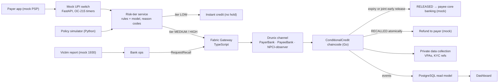
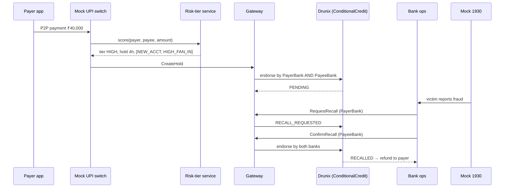

# TwoKey

**Instant UPI for everyone. A safety pause for scam payments — reversible only when both banks agree.**

TwoKey is a risk-tiered recall window for person-to-person UPI and IMPS payments, built on NPCI's **Drunix** ledger. Low-risk transfers settle instantly, exactly as today. Transfers that look like mule activity are held for a short, capped window, during which the payer's bank and the payee's bank can jointly reverse them. Every hold, release and recall is recorded on Drunix, and **no single bank can move a held payment on its own**.

Submitted to the **Drunix Hackathon × Citi (CHL-7007) — "Build the Future of Payments in India"**, Track 1: Real-Time Payments.

> **Project status:** Idea / deck stage. This repository currently holds the design and specification. The prototype is being built during the coding phase following the [roadmap](#roadmap). Nothing in this project moves real money; the UPI switch, bank core systems and the 1930 helpline are simulated and labelled as such.

---

## Contents

- [The problem](#the-problem)
- [The solution](#the-solution)
- [Features](#features)
- [Architecture](#architecture)
- [Technology stack](#technology-stack)
- [End-to-end workflow](#end-to-end-workflow)
- [Repository structure](#repository-structure)
- [Getting started](#getting-started)
- [Chaincode and API reference](#chaincode-and-api-reference)
- [Demo](#demo)
- [Security, privacy and reliability](#security-privacy-and-reliability)
- [Evaluation plan](#evaluation-plan)
- [Limitations](#limitations)
- [Roadmap](#roadmap)
- [Market and business model](#market-and-business-model)
- [Why TwoKey matters](#why-twokey-matters)

Further reading: [`docs/SOLUTION.md`](docs/SOLUTION.md) · [`docs/ARCHITECTURE.md`](docs/ARCHITECTURE.md)

---

## The problem

UPI settles a person-to-person payment in seconds, and that speed is now the fraudster's biggest advantage.

Most digital-payment fraud in India today is **authorised push-payment (APP) fraud**: a fake police officer, a "digital arrest" call, a fake job or investment scheme persuades the victim to approve the transfer themselves. Because the real account holder enters the real PIN, every security check passes. The money lands in a mule account — often opened days earlier — and is moved on within minutes.

| Signal | Figure |
| --- | --- |
| Cyber-financial fraud reported on the National Cybercrime Reporting Portal (NCRP) | ~₹22,931 crore in 2025 |
| Saved through CFCFRMS holds | ~₹11,158 crore across 32.8 lakh complaints by 30 June 2026 |
| Regulator's view | RBI's discussion paper (9 April 2026) states most digital-payment fraud is APP fraud and that post-transaction remedies recover little |

Today's response starts only after the loss: the victim calls 1930, and CFCFRMS freezes whatever is still left downstream. By then most funds have usually moved, and the freezes often catch innocent account holders.

RBI's April 2026 paper asks whether credits should be delayed ("lagged credit"). A **blanket** delay would slow millions of genuine payments every day. There is no mechanism today that delays **only the risky few** — and no shared, tamper-evident record that lets the two banks involved act on a held payment together.

## The solution

TwoKey adds one step to a P2P payment: a risk check that either credits instantly or creates a held `ConditionalCredit` on Drunix that only the two banks together can release or reverse.

1. **Risk-proportional hold** — only MEDIUM and HIGH risk transfers are held (starting values: 30 minutes and 4 hours, with a hard cap). Merchant payments, mandates, recurring debits, small amounts and long-standing beneficiaries are always exempt.
2. **Shared control** — the payer's bank and the payee's bank both endorse every state change, so neither can release a mule's money early or claw back a genuine payment alone.
3. **Before the loss, not after** — if the victim reports within the hold, the money has not left the payee account, so recall is a state change rather than a chase through layered accounts.
4. **Evidence for policy** — a reproducible simulator compares TwoKey with today's system and with a blanket delay, producing the friction–recovery trade-off that RBI's consultation asks for.

Whatever escapes the window still goes to CFCFRMS; TwoKey narrows the gap, it does not replace the existing workflow.

## Features

| Feature | Status |
| --- | --- |
| `ConditionalCredit` state machine (PENDING, RELEASED, RECALL_REQUESTED, RECALLED, DISPUTED) | Designed — to be built |
| Two-bank endorsement policy `AND(PayerBank, PayeeBank)` on every state change | Designed — to be built |
| Private data collection for VPAs, names and KYC references | Designed — to be built |
| Mock UPI switch following NPCI OC-215 timers and status-check limits | Designed — to be built |
| Rules-based risk tiers with reason codes | Designed — to be built |
| Recall flow triggered by a simulated 1930 report | Designed — to be built |
| Keeper (hold expiry) and reconciliation jobs | Designed — to be built |
| Dashboard with live credit states and audit trail | Designed — to be built |
| Policy simulator and friction–recovery frontier chart | Designed — to be built |
| LightGBM tier model with SHAP reason codes | Planned (stretch) |
| Segment fairness report | Planned |
| Scripted adversarial demos | Planned |
| IMPS path, DPIP-style score input, restitution hook | Stretch goals |

## Architecture



Python services make every decision; Drunix holds only the shared state that the two banks must agree on. See [`docs/ARCHITECTURE.md`](docs/ARCHITECTURE.md) for components, trust boundaries, failure handling and deployment.

## Technology stack

| Layer | Choice | Why |
| --- | --- | --- |
| Ledger | [NPCI Drunix](https://github.com/npci/drunix) test network (Docker) | Permissioned multi-organisation ledger with endorsement policies, private data and SQL state storage; fork of Hyperledger Fabric 2.5. Fallback: Fabric 2.5 |
| Chaincode | Go | Small, testable state machine |
| Gateway | Node/TypeScript, `@hyperledger/fabric-gateway` | Maintained Fabric Gateway SDK; exposes a small REST API to Python services |
| Services | Python, FastAPI | Mock switch, risk service, bank ops, mock 1930 |
| Model | scikit-learn / LightGBM, SHAP | Explainable tiering input; rules-only path works without it |
| Simulator | Python, NumPy, pandas | Seeded, reproducible policy comparison |
| Read model | PostgreSQL | Fed by chaincode events for dashboards and reconciliation |
| Dashboard | Streamlit or React | Credit states, reason codes, audit trail, frontier chart |
| Packaging | Docker Compose | One command brings up the full demo |

## End-to-end workflow



If no report arrives before `HoldUntil`, the keeper submits `Expire` and the credit is RELEASED to the payee.

## Repository structure

Planned layout (directories are added as each component is built):

```
TwoKey/
├── README.md
├── docs/
│   ├── ARCHITECTURE.md   # components, data flow, trust boundaries, deployment
│   └── SOLUTION.md       # problem, solution, user journey, validation criteria
├── network/              # Drunix/Fabric configs, 3 orgs, endorsement policies, PDC config
├── chaincode/            # Go ConditionalCredit contract + tests
├── gateway/              # TypeScript Fabric Gateway REST bridge
├── services/
│   ├── switch/           # mock UPI switch (FastAPI)
│   ├── risk/             # tiering rules + model (FastAPI)
│   ├── bankops/          # recall / release endpoints, keeper, reconciliation
│   └── helpline/         # mock 1930 reports
├── simulator/            # synthetic population + policy comparison
├── dashboard/            # UI + read model
├── tests/                # property and adversarial tests
└── docker-compose.yml
```

## Getting started

The runnable prototype is not yet in this repository. Once the components land, local execution will follow this shape:

**Prerequisites:** Docker and Docker Compose, Go 1.21+, Node.js 18+, Python 3.11+.

```bash
git clone https://github.com/Karman580/TwoKey.git
cd TwoKey

# 1. Bring up the 3-organisation Drunix test network and deploy chaincode
cd network && ./network.sh up && ./network.sh deploy

# 2. Start gateway, services, read model and dashboard
cd .. && cp .env.example .env && docker compose up --build
```

Expected configuration (a `.env.example` will ship with the code; never commit real credentials):

| Variable | Purpose |
| --- | --- |
| `GATEWAY_URL` | REST endpoint of the Fabric Gateway bridge |
| `CHANNEL_NAME` / `CHAINCODE_NAME` | Drunix channel and chaincode identifiers |
| `DATABASE_URL` | PostgreSQL read model |
| `VPA_HASH_SALT` | Per-network salt for hashing VPAs on the shared channel |
| `HOLD_MEDIUM_SECONDS` / `HOLD_HIGH_SECONDS` / `HOLD_MAX_SECONDS` | Tier hold durations and hard cap |

## Chaincode and API reference

### Chaincode functions

| Function | Caller | Endorsement | Effect |
| --- | --- | --- | --- |
| `CreateHold` | Mock switch via gateway | PayerBank AND PayeeBank | New credit in PENDING |
| `RequestRecall` | PayerBank | PayerBank | PENDING → RECALL_REQUESTED |
| `ConfirmRecall` | PayeeBank | PayerBank AND PayeeBank | → RECALLED; refund event |
| `ReleaseEarly` | PayeeBank | PayerBank AND PayeeBank | PENDING → RELEASED |
| `Expire` | Keeper service | PayerBank AND PayeeBank | PENDING past `HoldUntil` → RELEASED |
| `RaiseDispute` | Either bank | Raiser AND NPCI-observer | → DISPUTED, held until resolved |
| `GetCredit`, `History` | Any member | Query only | Read state and audit trail |

### Off-chain REST endpoints

| Service | Endpoint | Purpose |
| --- | --- | --- |
| Mock switch | `POST /upi/pay` | Accept a P2P payment, call risk service, route LOW to instant credit or MEDIUM/HIGH to `CreateHold` |
| Mock switch | `GET /upi/status/{txnRef}` | Status check, rate-limited per NPCI OC-215 rules |
| Risk service | `POST /risk/score` | Return tier, hold duration and reason codes |
| Bank ops | `POST /bank/{id}/recall` | Victim report → `RequestRecall` |
| Mock 1930 | `POST /report` | Simulated helpline complaint that triggers the payer bank |
| Dashboard API | `GET /credits`, `GET /metrics` | PostgreSQL view of credits and metrics |

Example request (planned contract):

```bash
curl -X POST http://localhost:8000/risk/score \
  -H "Content-Type: application/json" \
  -d '{"txnRef":"RRN123","payerVpa":"alice@bank","payeeVpa":"x9@bank","amountPaise":4000000}'
```

```json
{"tier":"HIGH","holdSeconds":14400,"reasonCodes":["NEW_ACCT","HIGH_FAN_IN"]}
```

## Demo

The demo is designed around one visible moment: **two identical ₹40,000 transfers that behave differently, followed by a recall one bank cannot fake.**

1. Send ₹40,000 to a two-year-old account with normal history → tier LOW, settles instantly.
2. Send ₹40,000 to a three-day-old account receiving from 14 payers → tier HIGH, 4-hour hold with `NEW_ACCT` and `HIGH_FAN_IN`.
3. The victim "calls 1930" → payer bank requests recall, payee bank confirms → RECALLED, refund visible.
4. The payee bank tries to release a held credit alone → rejected by the endorsement policy on screen.
5. The frontier chart: genuine transfers delayed by a blanket lag versus TwoKey, for the same recovery (labelled as simulation).

Screenshots and a recorded walkthrough will be added once the prototype runs.

## Security, privacy and reliability

**Security and privacy**

- No VPAs, names or KYC data on the shared channel — only salted hashes, amounts, tiers, reason codes and states.
- VPAs and KYC references sit in a private data collection visible only to the two banks of each credit, supporting DPDP Act 2023 data-minimisation principles.
- Wrong on-chain state is corrected only by compensating transactions, never by editing history.
- Production would need HSM-held keys and nodes hosted in India (RBI payment-data localisation); the prototype uses the default Fabric CA.
- Raft ordering tolerates crashes, not malicious orderers, so governance rests with known regulated institutions.

**Reliability**

| Failure | Handling |
| --- | --- |
| Duplicate `CreateHold` for one TxnRef | Idempotent: returns the existing credit |
| Keeper down at expiry | On restart, scans PENDING credits past `HoldUntil` and submits `Expire` |
| Mock core-banking credit fails after RELEASED | Payout job retries with backoff, flags after 3 failures |
| Gateway loses connection mid-submit | Client re-queries by TxnRef before retrying |
| Switch, ledger and core banking disagree | Reconciliation job compares all three and raises exceptions |

**Adversarial scenarios (scripted tests)**

| Attack | Expected outcome |
| --- | --- |
| Colluding payee bank releases early alone | Endorsement fails; credit stays PENDING |
| Payer bank recalls without payee bank | Only RECALL_REQUESTED; funds move only on joint confirm |
| Recall and expiry submitted at the same time | One wins deterministically by state check |
| Replayed recall request | Rejected |
| Smurfing just under the value floor | `SPLIT_PATTERN` and fan-in features raise the tier |

**Responsible AI:** every hold shows its reason codes and expiry, has a maximum duration, can be released early with joint endorsement, and comes with an appeal path. False-hold rates are reported by segment, because "new account" signals can unfairly affect newly banked and rural users.

## Evaluation plan

Three policies — status quo, blanket delay, TwoKey — on one million synthetic P2P transfers, sweeping fraud prevalence (0.05–0.5%), mule cash-out time and victim reporting delay.

| Metric | Target (hypothesis, not a result) |
| --- | --- |
| Recovery ratio vs blanket delay | ≥ 80% of what a blanket delay recovers |
| Genuine transfers delayed vs blanket delay | ≤ 10% of the blanket delay's count |
| Unilateral release or recall | Always rejected |
| Recall–expiry races, replays | 100% deterministic in property tests |
| False-hold rate by segment | Reported, disparities called out |
| Ledger latency and throughput | Reported for a laptop network only |

A negative result — mules cashing out faster than any acceptable hold, or tiers unable to separate mules from genuine new accounts — will be reported as such.

## Limitations

- Design stage: no runnable code is in the repository yet.
- All rails (UPI switch, core banking, 1930/NCRP) are simulated; no NPCI or Citi connectivity is claimed.
- Evaluation uses synthetic data and an assumed mule cash-out distribution; real calibration needs bank fraud data.
- Live operation would require an RBI direction on lagged credit, NPCI scheme rules and authorisation under the Payment and Settlement Systems Act 2007.
- Drunix documentation is thin; Node/Java chaincode support on Drunix is unverified, so Go is used.

## Roadmap

| Week | Deliverable |
| --- | --- |
| 0 | Deck submitted; questions sent to organisers |
| 1 | Drunix network (3 orgs), `ConditionalCredit` chaincode with tests, endorsement policy, gateway |
| 2 | Mock switch and core banking, rules-only tiers, first end-to-end slice |
| 3 | Dashboard, simulator and first frontier chart, keeper and reconciliation |
| 4 | Model tiers with SHAP reason codes, segment fairness report, adversarial demos |
| 5 | Private data collections, latency benchmark, recorded demo backup |
| 6 | README with mock boundaries, pitch rehearsal, stretch goals |

**Adoption path:** an on-us pilot inside a single bank (no inter-bank change) → an NPCI or RBI regulatory sandbox → a UPI scheme rule.

## Market and business model

- **Customers:** issuer and beneficiary banks, with NPCI as scheme operator. Beneficiaries are P2P payers — especially senior citizens and first-time digital users — and innocent account holders caught in downstream freezes.
- **Value proposition:** recover fraud while funds are still in the first account, without slowing the large majority of payments; fewer wrongful freezes and complaint-handling costs for banks.
- **Distribution:** on-us pilot with one bank, then a scheme-level rule through NPCI.
- **Monetisation (hypotheses):** per-bank licensing of the risk-tier and recall service for on-us use; scheme-level operation funded through NPCI participation fees.
- **Alternatives:** CFCFRMS and the Money Restoration Module act after the fact; RBIH tools such as MuleHunter.AI and the DPIP prototype score risk but do not hold settlement. The UK allows payer-side delays of up to four business days; Singapore mandates a 12-hour cooling-off after security-token activation — neither is risk-tiered per transfer with shared two-bank control.
- **Risks:** the instant-payment ethos, customer-experience complaints, dependence on an RBI direction, and the question of whether NPCI would implement holds centrally instead.

## Why TwoKey matters

UPI's speed is its strength, and today it is also its biggest fraud vulnerability. TwoKey keeps instant payments instant for almost everyone, while giving the riskiest few a short window in which they can still be reversed — a window that two banks hold jointly, with a record neither can rewrite alone. It is built to answer the exact question RBI is asking, with evidence rather than opinion.
