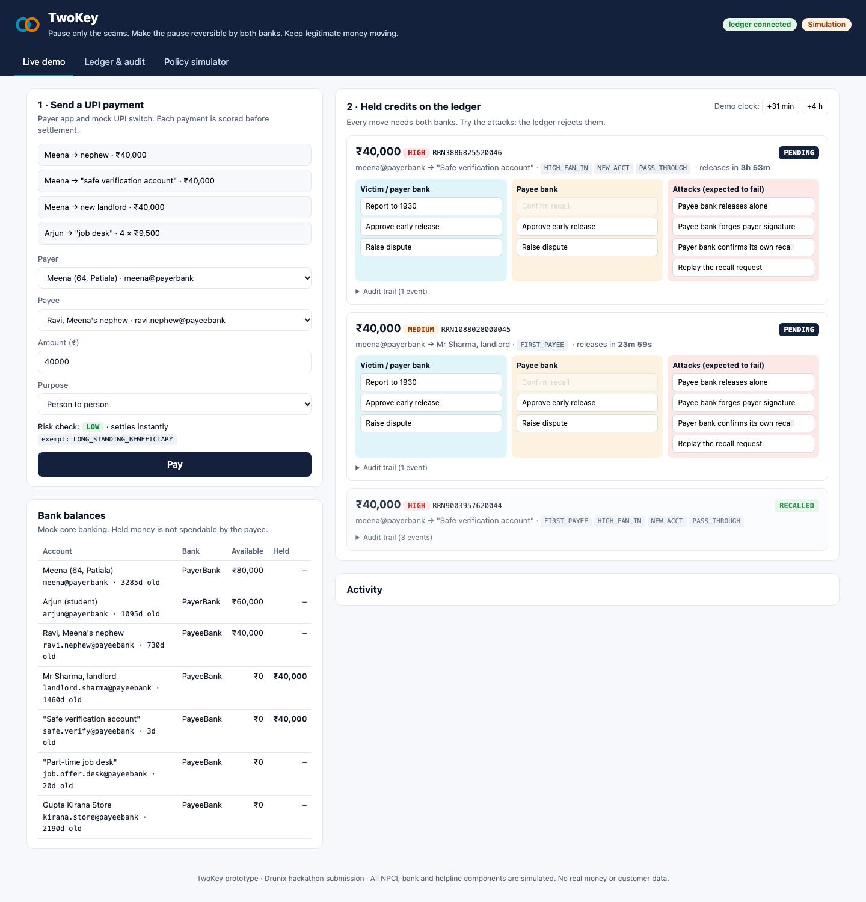
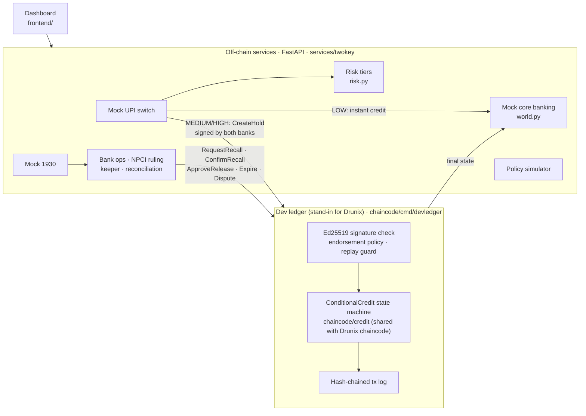
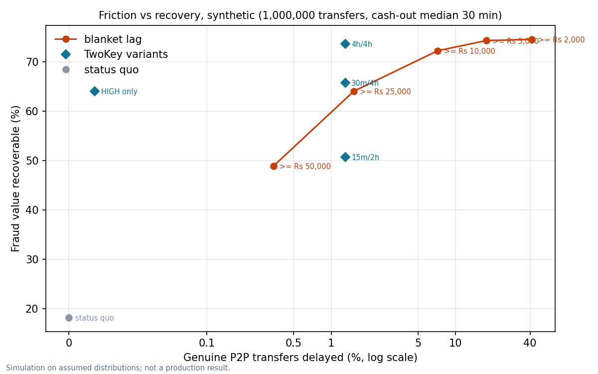

# TwoKey

**Pause only the scams. Make the pause reversible by both banks. Keep legitimate money moving.**

TwoKey is a risk-tiered recall window for person-to-person UPI payments, designed for NPCI's **Drunix** ledger. Low-risk transfers settle instantly, exactly as today. Transfers that look like mule activity become a held `ConditionalCredit` for a short, capped window. During that window the payer's bank and the payee's bank can reverse it **only together**. No single bank can release or claw back a held payment alone.

Submitted to the **Drunix Hackathon × Citi (CHL-7007) — "Build the Future of Payments in India"**, Track 1: Real-Time Payments.

> **Simulation notice.** The UPI switch, both banks' core systems and the 1930 helpline are simulated. No real money, NPCI connectivity or customer data is used. The Drunix chaincode is written and compiles; the local demo runs the same state machine on a signature-checking dev ledger instead of a Drunix network ([why](#implementation-status)).



| Start here | |
| --- | --- |
| 📊 Presentation | [`presentation/TwoKey_Submission.pdf`](presentation/TwoKey_Submission.pdf) (14 slides) · [project description](presentation/TwoKey_Project_Description.pdf) · [notes](presentation/README.md) |
| 🧭 Problem and solution | [`docs/SOLUTION.md`](docs/SOLUTION.md) |
| 🏗 Architecture | [`docs/ARCHITECTURE.md`](docs/ARCHITECTURE.md) |
| ▶️ Run it | [Quick start](#quick-start) · [`docs/SETUP.md`](docs/SETUP.md) |
| 🔌 API | [`docs/API.md`](docs/API.md) |
| 🔐 Security | [`docs/SECURITY.md`](docs/SECURITY.md) |
| 🗺 Roadmap | [`docs/ROADMAP.md`](docs/ROADMAP.md) |

---

## The problem

UPI settles a P2P payment in seconds, and the money cannot be pulled back. In **authorised push-payment (APP) fraud** nobody hacks the victim. A fake police officer, a "digital arrest" call or a fake job persuades them to approve the transfer themselves, so every security check passes. The money lands in a **mule account**, usually opened recently, and moves on within minutes. By the time the victim calls 1930, most of it is gone.

- The National Cybercrime Reporting Portal recorded about **₹22,931 crore** of cyber-financial fraud in 2025.
- CFCFRMS had saved about **₹11,158 crore** across 32.8 lakh complaints by mid-2026. That is roughly one rupee in five of what was reported lost in 2021–2025, on periods that do not match exactly.
- RBI's discussion paper of 9 April 2026 says most digital-payment fraud is APP fraud and asks for views on "lagged credit". A **blanket** delay would slow millions of genuine payments.

(Figures as cited in the [project description](presentation/TwoKey_Project_Description.pdf).)

## The solution

1. **Check the risk at payment time.** Every eligible P2P payment is scored on payee account age, first-time payee, distinct payers in 24 h, inflow velocity, pass-through ratio, amount anomaly and split patterns.
2. **Settle the safe ones instantly.** LOW tier, merchant payments, mandates, small amounts and long-standing beneficiaries go through as today.
3. **Hold only the risky ones.** MEDIUM (30 min) and HIGH (4 h, hard cap) become a `ConditionalCredit` with reason codes the payer can see.
4. **Let the victim pull it back.** A 1930 report during the hold makes the payer bank request a recall. The payee bank confirms, and the money returns.
5. **Two keys for every move.** Every state change needs both banks' endorsement. Disputes also need NPCI's co-signature.
6. **Release on time.** If no report arrives, the hold expires and the payee is paid.

**Target users:** issuer and beneficiary banks and NPCI as operators. P2P payers benefit, especially senior citizens and first-time digital users. So do innocent account holders who today get caught in downstream freezes.

## Implementation status

| Component | Status | Code |
| --- | --- | --- |
| `ConditionalCredit` state machine (PENDING → RELEASED / RECALL_REQUESTED → RECALLED / DISPUTED) with endorsement rule, hold cap, idempotency, audit events | ✅ Built, unit- and property-tested | [`chaincode/credit/credit.go`](chaincode/credit/credit.go) |
| Drunix / Fabric chaincode: MSP identity, tx timestamp, state-based endorsement `AND(payer, payee)` (+NPCI when disputed), private data, events | ✅ Written, compiles, `go vet` clean · ⚠️ **not yet deployed to a Drunix network** | [`chaincode/main.go`](chaincode/main.go), [`collections_config.json`](chaincode/collections_config.json) |
| Dev ledger: Ed25519 signature per organisation, endorsement enforcement, replay protection, hash-chained log, restart replay | ✅ Built and tested. **A local stand-in for Drunix, not a blockchain** | [`chaincode/cmd/devledger`](chaincode/cmd/devledger/main.go) |
| Rules-first risk tiers with 7 reason codes and exemptions | ✅ Built | [`services/twokey/risk.py`](services/twokey/risk.py) |
| Mock UPI switch, mock core banking, mock 1930, bank ops, NPCI ruling, keeper (expiry) and settlement reconciliation | ✅ Built (simulated rails) | [`services/twokey/app.py`](services/twokey/app.py), [`world.py`](services/twokey/world.py) |
| Dashboard: payments, live held credits, per-bank actions, attack buttons, audit trail, ledger view, simulator | ✅ Built | [`frontend/`](frontend/) |
| Policy simulator (status quo vs blanket lag vs TwoKey, 1M transfers, sensitivity sweep) | ✅ Built | [`services/twokey/simulator.py`](services/twokey/simulator.py) |
| TypeScript Fabric Gateway bridge, Drunix 3-org network scripts | 🔜 Planned. The services talk to the dev ledger instead | [roadmap](docs/ROADMAP.md) |
| NPCI OC-215 response timers and status-check rate limits on the mock switch | 🔜 Planned | |
| LightGBM tiers with SHAP reason codes, segment fairness report | 🔜 Planned (stretch) | |

**Why a dev ledger:** this machine had no Docker, so a Drunix/Fabric network could not be started. The dev ledger imports the same Go package as the chaincode. The rules a judge sees enforced in the demo are therefore the rules that would run on Drunix, while network-level endorsement is replaced by explicit Ed25519 signature checks.

## Quick start

Prerequisites: **Go 1.22+**, **Python 3.11+**, `make`, `curl`.

```bash
git clone https://github.com/Karman580/TwoKey.git
cd TwoKey
make setup      # .venv, Python deps, Go modules, fresh keys in .env
make dev        # dev ledger on :8081 + services and dashboard on http://127.0.0.1:8000
```

In a second terminal, run the scripted demo against the live stack:

```bash
make demo
```

```text
1. Meena pays her nephew Rs 40,000 (two-year-old account, paid monthly)
   tier LOW -> SUCCESS (LONG_STANDING_BENEFICIARY)
2. Meena pays the 'safe verification account' Rs 40,000 (3 days old, 13 payers today)
   tier HIGH -> HELD for 4h, reasons ['NEW_ACCT', 'FIRST_PAYEE', 'HIGH_FAN_IN', 'PASS_THROUGH']
3. The payee bank tries to move the held credit on its own
   unilateral-release: blocked=True ENDORSEMENT_POLICY_FAILURE -> credit still PENDING
   forged-endorsement: blocked=True INVALID_SIGNATURE -> credit still PENDING
4. Meena's son calls 1930; the payer bank requests a recall
   replaying that recall: blocked=True REPLAY
5. The payee bank confirms the recall
   credit RECALLED; endorsed by ['PayeeBank', 'PayerBank']
   meena@payerbank: available Rs 160,000, held Rs 0
6. Ledger: 3 committed transactions, hash chain valid=True
```

(Output abridged from an actual run.) Full instructions, configuration and troubleshooting: [`docs/SETUP.md`](docs/SETUP.md).

### Demo walkthrough in the dashboard

1. **Meena → nephew ₹40,000**: LOW, settles instantly (long-standing beneficiary).
2. **Meena → "safe verification account" ₹40,000**: HIGH, held 4 h with `NEW_ACCT`, `HIGH_FAN_IN`, …. The payee's balance shows the money as *held*, not available.
3. Click the **attack** buttons on the held credit. Each one goes to the ledger and is rejected, and the credit stays PENDING.
4. **Report to 1930** → RECALL_REQUESTED → payee bank **Confirm recall** → RECALLED, and Meena's balance is restored.
5. **Meena → new landlord**: MEDIUM, 30 min. Click **+31 min** on the demo clock and the keeper releases it to the landlord.
6. **Arjun → "job desk" 4 × ₹9,500**: the first two splits pass, then `SPLIT_PATTERN` holds the rest.
7. **Ledger & audit** tab: hash-chained transactions with the verified endorsers for each, plus the shared vs bank-private view of a credit.
8. **Policy simulator** tab: the friction–recovery chart and a re-run form.

## Architecture



Python services make every decision; the ledger holds only the shared state the two banks must agree on, with salted VPA hashes instead of identities. The planned Drunix deployment replaces the dev ledger with three peers (PayerBank, PayeeBank, NPCI observer) running [`chaincode/main.go`](chaincode/main.go). Details, sequence diagrams, trust boundaries and failure handling are in [`docs/ARCHITECTURE.md`](docs/ARCHITECTURE.md).

## Policy simulator result (synthetic)

`make simulate` runs 1,000,000 synthetic P2P transfers (seed 42, 0.2% fraud, mule cash-out median 30 min) under three policies. Blanket lag means a 4 h hold on every transfer of ₹10,000 or more.

| Policy | Fraud value recoverable | Genuine transfers delayed |
| --- | --- | --- |
| Status quo | 18.2% | 0 |
| Blanket lag | 72.3% | 72,090 (7.2%) |
| **TwoKey 30 min / 4 h** (default) | **65.8%** (91.0% of blanket ✅ target ≥ 80%) | **12,953 (1.3%)** (18.0% of blanket ❌ target ≤ 10%) |
| TwoKey, HIGH tier only | 64.1% (88.6% of blanket) | 186 (0.3% of blanket) |



**How to read this.** Under these *assumed* distributions the default policy meets the recovery hypothesis but **misses the friction hypothesis**: MEDIUM holds on first-time payees delay more genuine payments than the target allows. Holding only HIGH meets both. When the mule signal is weakened (fraud feature rates moved halfway toward genuine), TwoKey recovers only 29–90% of what the blanket lag recovers. The result depends on how well real mule accounts can be separated from genuine new ones, and only bank data can show that. These are synthetic results, not production evidence. Assumptions are listed in [`simulator.py`](services/twokey/simulator.py) and [`simulator/README.md`](simulator/README.md).

## Technology stack

| Layer | Choice | Why |
| --- | --- | --- |
| Shared state | Go state machine ([`chaincode/credit`](chaincode/credit/credit.go)) | One implementation used by both the Drunix chaincode and the dev ledger |
| Chaincode | Go, `fabric-contract-api-go` v1.2.2 | Drunix is a Fabric 2.5-compatible fork; Go chaincode is the best-supported path |
| Dev ledger | Go stdlib (`net/http`, `crypto/ed25519`, `sha256`) | Runs without Docker; enforces endorsement by signature |
| Services | Python 3.11, FastAPI, pydantic, httpx, `cryptography` | Input validation at the boundary; small, readable services |
| Simulator | NumPy, matplotlib | Vectorised, seeded, about 1 s for 1M transfers |
| Dashboard | Plain HTML/CSS/JS served by FastAPI | No build step; every button calls a real endpoint |
| CI | GitHub Actions | Go vet/test, gofmt, ruff, pytest (includes the real Go ledger) |

## Repository structure

```text
TwoKey/
├── README.md                  ← you are here
├── SECURITY.md                vulnerability reporting
├── Makefile                   setup · dev · demo · test · lint · simulate
├── .env.example               configuration (secrets generated by scripts/gen_keys.py)
├── presentation/              submission deck (PDF) and project description
├── docs/                      SOLUTION · ARCHITECTURE · SETUP · API · SECURITY · ROADMAP · images/
├── chaincode/
│   ├── credit/                ConditionalCredit state machine + property tests
│   ├── main.go                Drunix/Fabric contract
│   ├── collections_config.json  private data collection for VPAs/KYC refs
│   └── cmd/devledger/         signature-checking local ledger + tests
├── services/
│   ├── twokey/                app.py (API) · risk.py · world.py · ledger.py · simulator.py
│   └── tests/                 end-to-end tests against the real dev ledger
├── frontend/                  dashboard (index.html, app.js, styles.css)
├── simulator/                 results.json from the 1M-transfer run
├── scripts/                   gen_keys.py · dev.sh · demo.py
└── .github/workflows/ci.yml
```

## Testing

```bash
make test    # go vet + go test (state machine, property test, dev ledger) and pytest (API end to end)
make lint    # gofmt + ruff
```

The Python tests build and start the real Go dev ledger, so endorsement and signature checks are exercised end to end. They cover the full user journey, every attack, expiry, dispute with NPCI ruling, input validation, ledger-down behaviour and the simulator. The Go property test runs 5,000 random operation sequences and checks that the machine is deterministic, that final states never change, that no change commits without both banks, and that nothing releases before `HoldUntil`.

## Security and privacy

- **No single bank can move a held credit.** Every transaction must carry valid signatures from both banks (and NPCI once disputed). Forged, missing and replayed endorsements are rejected and tested.
- **No personal data on the shared ledger.** Only salted HMAC-SHA256 hashes of VPAs, amounts, tiers, reason codes, states and events. Cleartext VPAs stay in the (simulated) bank systems; on Drunix they would go to a private data collection.
- **Fails closed.** If the ledger is unreachable, a risky payment is declined before any money moves.
- **Validated input** at every API boundary (VPA format, amount limits, txnRef pattern, enumerated outcomes). Errors return codes, not stack traces.
- **Secrets** are generated locally into `.env` (git-ignored, mode 600). Nothing secret is committed.
- **Demo limitation:** one process holds all three organisations' keys so that one person can drive the demo. In a real deployment each bank holds only its own key, in an HSM. The API has no authentication because it is a local single-operator demo bound to `127.0.0.1`.

More detail, including the threat model and residual risks: [`docs/SECURITY.md`](docs/SECURITY.md).

## Limitations

- No Drunix network has been run yet; the chaincode compiles but is untested on peers. The dev ledger has no ordering service, consensus or peer distribution.
- All rails (UPI switch, core banking, 1930/NCRP) are simulated, and demo accounts are synthetic.
- Risk thresholds are starting values, not calibrated. "New account" signals can unfairly affect newly banked and rural users; false-hold rates must be reported by segment before any pilot.
- Simulator results depend on assumed distributions, especially mule cash-out speed, which is not public.
- Live operation needs an RBI direction on lagged credit, NPCI scheme rules and authorisation under the Payment and Settlement Systems Act 2007.

## Market and adoption

- **Customers:** issuer and beneficiary banks, with NPCI as scheme operator.
- **Value:** recover fraud while the funds are still in the first account, without slowing the large majority of payments, with fewer wrongful downstream freezes and less complaint handling.
- **Adoption path:** an on-us pilot inside one bank (no inter-bank change) → an NPCI or RBI regulatory sandbox with two banks on a Drunix partition → a UPI scheme rule.
- **Monetisation (hypotheses, not validated):** per-bank licensing of the risk-tier and recall service for on-us use, or scheme-level operation funded through participation fees.
- **Alternatives:** CFCFRMS and the Money Restoration Module act after the loss. RBIH tools such as MuleHunter.AI and the DPIP prototype score risk but do not hold settlement. The UK allows payer-side delays of up to four business days, and Singapore applies a 12-hour cooling-off after security-token activation; neither is risk-tiered per transfer with shared two-bank control.
- **Risks:** the instant-payment ethos, customer complaints about holds, dependence on an RBI direction, and the possibility that NPCI implements holds centrally in the switch instead.

See [`docs/SOLUTION.md`](docs/SOLUTION.md) and [`docs/ROADMAP.md`](docs/ROADMAP.md).

## License

No open-source license has been chosen yet, so all rights are reserved by the author. Third-party dependencies keep their own licenses (Hyperledger Fabric libraries: Apache-2.0; FastAPI, NumPy, matplotlib: BSD/MIT-style).
