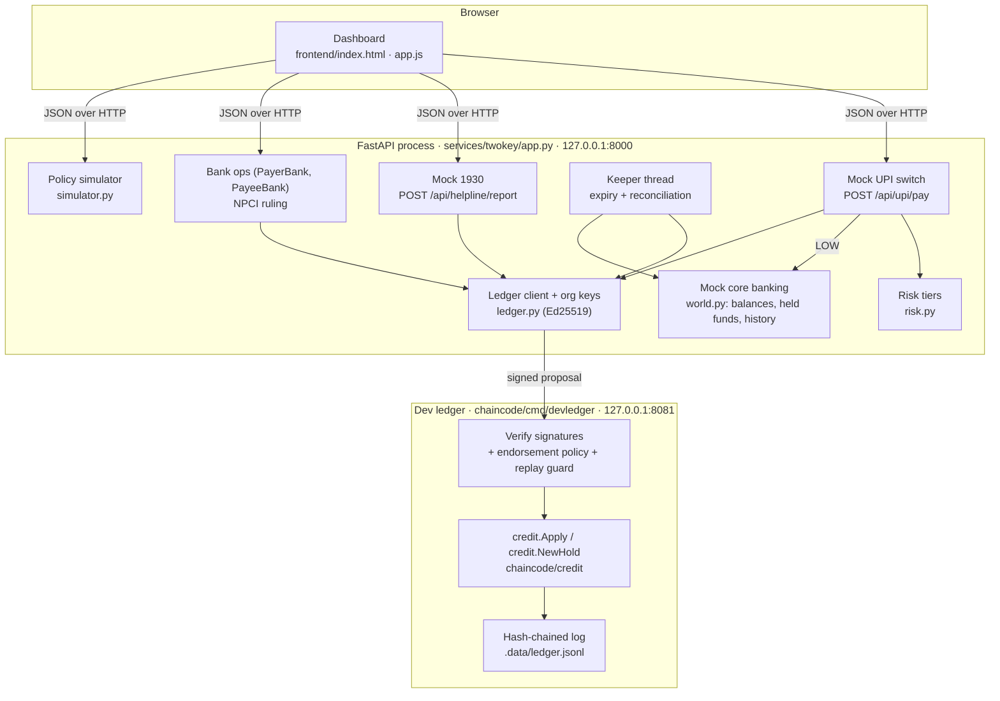
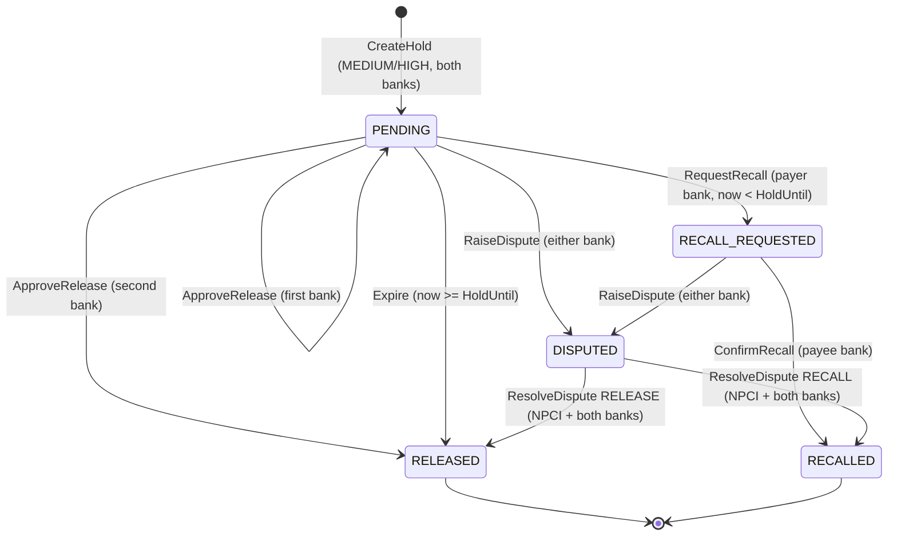
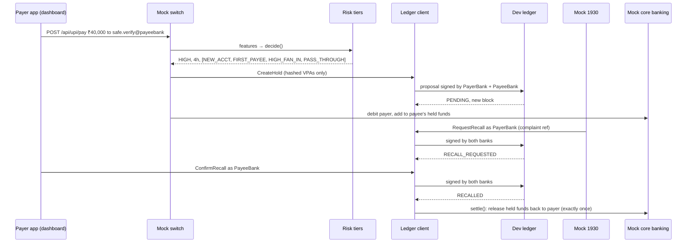
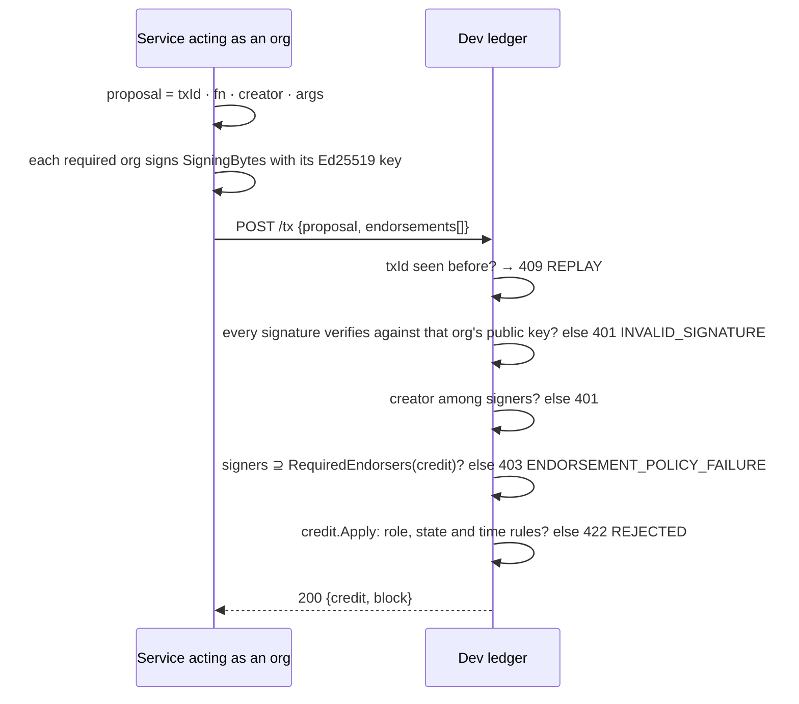
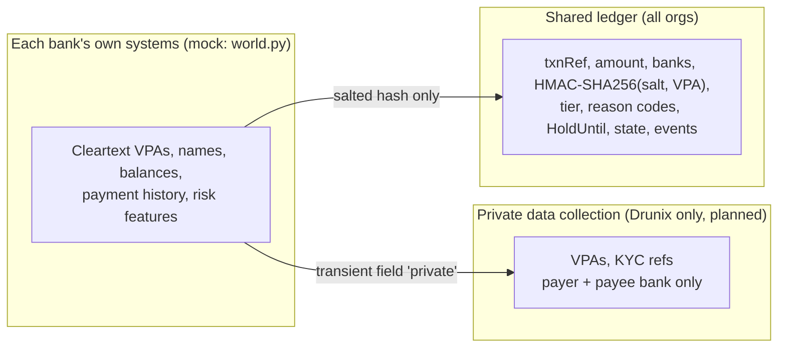
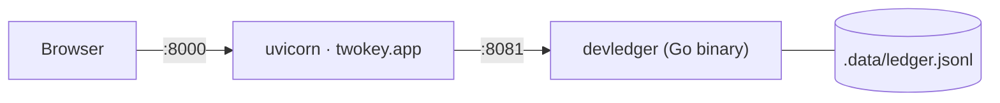

# TwoKey — Architecture

This document describes **what is implemented** in this repository, then the planned Drunix deployment, kept clearly separate. Everything labelled *mock* is a simulation and is never presented as a live NPCI, bank or Citi integration.

## 1. Design principle

Python services make every decision; the ledger holds only the shared state that two banks must agree on.

A held UPI credit is effectively co-owned by two regulated institutions with opposing incentives. The payer's bank wants funds returned to a victim; the payee's bank must protect its customer from wrongful reversal. TwoKey puts exactly that object, the `ConditionalCredit`, on a shared ledger where every change needs both banks.

## 2. Implemented system

| Component | File | Responsibility | Real or mock |
| --- | --- | --- | --- |
| State machine | [`chaincode/credit/credit.go`](../chaincode/credit/credit.go) | States, transitions, who may call what, hold cap, endorsement rule, audit events. Pure function of (credit, tx) | Real |
| Drunix chaincode | [`chaincode/main.go`](../chaincode/main.go) | Maps the state machine onto the Fabric stub: MSP identity, tx timestamp, state-based endorsement per key, private data, `CreditChanged` events | Real code, **not yet deployed** |
| Dev ledger | [`chaincode/cmd/devledger/main.go`](../chaincode/cmd/devledger/main.go) | Local stand-in for the network. Verifies Ed25519 endorsements, applies the same state machine, rejects replays, keeps a hash-chained append-only log and replays it on restart | Real, local only |
| Risk tiers | [`services/twokey/risk.py`](../services/twokey/risk.py) | Seven reason codes → tier; exemptions; the same rule is vectorised for the simulator | Real (uncalibrated thresholds) |
| Bank world | [`services/twokey/world.py`](../services/twokey/world.py) | Synthetic accounts and history, feature computation, balances and held funds, exactly-once settlement | Mock |
| API | [`services/twokey/app.py`](../services/twokey/app.py) | Switch, risk, 1930, bank ops, NPCI, keeper, attack demos, simulator, demo controls | Real logic over mock rails |
| Ledger client | [`services/twokey/ledger.py`](../services/twokey/ledger.py) | Builds and signs proposals, salted VPA hashing, error mapping | Real |
| Simulator | [`services/twokey/simulator.py`](../services/twokey/simulator.py) | Status quo vs blanket lag vs TwoKey over synthetic transfers | Real code, synthetic data |
| Dashboard | [`frontend/`](../frontend/) | Payment form, live credits with per-bank actions, attacks, audit trail, ledger and simulator views | Real |

## 3. The ConditionalCredit state machine

LOW-tier transfers never touch the ledger. Rules enforced in [`credit.go`](../chaincode/credit/credit.go):

| Function | Submitted by | Endorsement required | Extra rules |
| --- | --- | --- | --- |
| `CreateHold` | a party bank | payer bank AND payee bank | tier MEDIUM/HIGH, `0 < hold ≤ 4 h` (cap lives in chaincode), ≥ 1 reason code, different banks; idempotent per `txnRef` |
| `RequestRecall` | payer bank only | both banks | only while `now < HoldUntil` |
| `ConfirmRecall` | payee bank only | both banks | only from RECALL_REQUESTED |
| `ApproveRelease` | either bank, once each | both banks | second distinct approval releases |
| `Expire` | either bank (keeper) | both banks | only when `now ≥ HoldUntil` |
| `RaiseDispute` | either bank | both banks | reason required; freezes the credit |
| `ResolveDispute` | NPCI observer only | both banks AND NPCI | outcome RELEASE or RECALL |

**Recall–expiry race.** Both use the same timestamp test with a strict boundary: a recall at `t < HoldUntil` wins and blocks expiry, and at `t ≥ HoldUntil` only expiry is valid. In Fabric, two conflicting transactions in the same block are resolved by MVCC; the second is invalidated.

**Design decision (documented gap).** The proposal says "every release needs both banks' endorsement" and also that the payee bank can release early. The implementation reconciles the two: every transaction is endorsed by both banks, and an *early* release additionally needs an explicit `ApproveRelease` from each bank, so neither bank's operator can release on its own initiative.

## 4. Main sequence: fraud path

**Normal path:** after `HoldUntil` the keeper thread ([`TwoKey.keeper_once`](../services/twokey/app.py)) submits `Expire`, and `world.settle` moves the held funds into the payee's balance. The same loop reconciles any final ledger state that core banking has not applied yet, for example after a crash between commit and settlement.

## 5. Authentication and authorisation flow

The ledger receives **public keys only** (`TWOKEY_PUBKEYS`). On Drunix the same roles map to MSP certificates: the creator's MSP ID comes from `GetClientIdentity()`, and endorsement is enforced by the network through a state-based endorsement policy set on each credit key ([`setKeyPolicy`](../chaincode/main.go)).

The HTTP API itself is unauthenticated; see [SECURITY.md](SECURITY.md#residual-risks).

## 6. Data and trust boundaries

- **Shared:** no personal data. VPAs are HMAC-SHA256 with a network salt (`VPA_HASH_SALT`), so equal VPAs can be linked by members but not reversed without the salt.
- **Private (planned on Drunix):** [`collections_config.json`](../chaincode/collections_config.json) restricts the collection to the two bank orgs. The chaincode writes cleartext only when it is passed as transient data.
- **Off-chain:** features and history never leave the bank.
- **Correction:** history is never edited. Wrong outcomes are fixed by new transactions (dispute → NPCI ruling).

## 7. Persistence

| Store | Where | Durability |
| --- | --- | --- |
| Ledger transactions | `DEVLEDGER_DATA` (`.data/ledger.jsonl`), append-only JSON lines, mode 600 | Survives restart; state and hash chain are rebuilt by replaying the log |
| Bank world (balances, history) | In memory in the services process | Reset on restart. Credits from earlier sessions still appear, marked "from an earlier demo session" |
| Simulation results | `simulator/results.json` (committed) | Regenerated by `make simulate` |

A PostgreSQL read model, as in the original design, was not needed for the demo: the dashboard reads the ledger directly. It becomes useful when credits number in the thousands (see the [roadmap](ROADMAP.md)).

## 8. Failure handling

| Failure | Handling | Tested |
| --- | --- | --- |
| Ledger unreachable on a risky payment | 503 `LEDGER_UNAVAILABLE`; payment declined **before** any balance changes | ✅ `test_ledger_down_fails_closed` |
| Duplicate `CreateHold` for one txnRef | Same request → returns existing credit, no new block; different request → 409 | ✅ Go |
| Replayed transaction | 409 `REPLAY` | ✅ Go + Python |
| Report after hold ended | Rejected by state machine; helpline answers `TOO_LATE_OR_INVALID` and the case falls back to CFCFRMS | ✅ |
| Report on an instant (LOW) payment | `NOT_HELD`; existing CFCFRMS route | Manually (dashboard) |
| Keeper down at expiry | Next keeper run expires every PENDING credit past `HoldUntil` | ✅ (`/api/dev/advance` path) |
| Crash between ledger commit and settlement | Keeper reconciles the final ledger state into core banking; `settle` is idempotent | ✅ by construction (`settled` flag) |
| Tampered ledger log | Hash recomputation fails; `/chain` reports `valid: false`; replay re-verifies every signature | ✅ Go |

## 9. Deployment

**Implemented (local):** two processes on one machine, both bound to `127.0.0.1`. See [SETUP.md](SETUP.md).

**Planned (Drunix test network):** three orgs (PayerBank, PayeeBank, NPCIObserver) with a Raft orderer in Docker, `chaincode/` installed as `conditionalcredit` with `--collections-config chaincode/collections_config.json`, and a Fabric Gateway client replacing [`ledger.py`](../services/twokey/ledger.py). Drunix is backward-compatible with Fabric 2.5.x, so Fabric 2.5 is the fallback.

**Production would require:** one peer set per bank and NPCI hosted in India (RBI data localisation), HSM-held keys, integration with the real UPI switch and bank CBS, and an RBI direction permitting risk-based lagged credit.

## 10. Trade-offs and scalability

- **Only held credits touch the ledger.** In the 1M-transfer simulation, 1.3% of genuine transfers were held under the default policy, so ledger load scales with risky volume, not with all UPI volume.
- **Why not a central database?** NPCI could hold credits centrally in the switch. A ledger adds enforced two-party control, non-repudiation and a neutral audit trail for disputes. This trade-off is stated openly.
- **One lock per process** in the services and dev ledger (marked `ponytail:` in code). That is fine for a demo; a real network orders transactions instead.
- **Raft ordering** on Drunix tolerates crashes, not malicious orderers; governance rests with known regulated institutions.
- **No performance claims.** Nothing has been benchmarked on a Drunix network.
