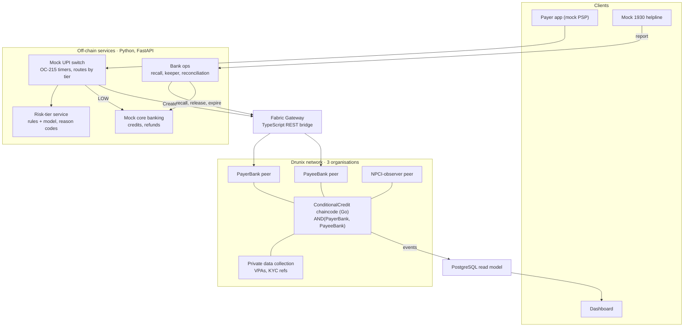
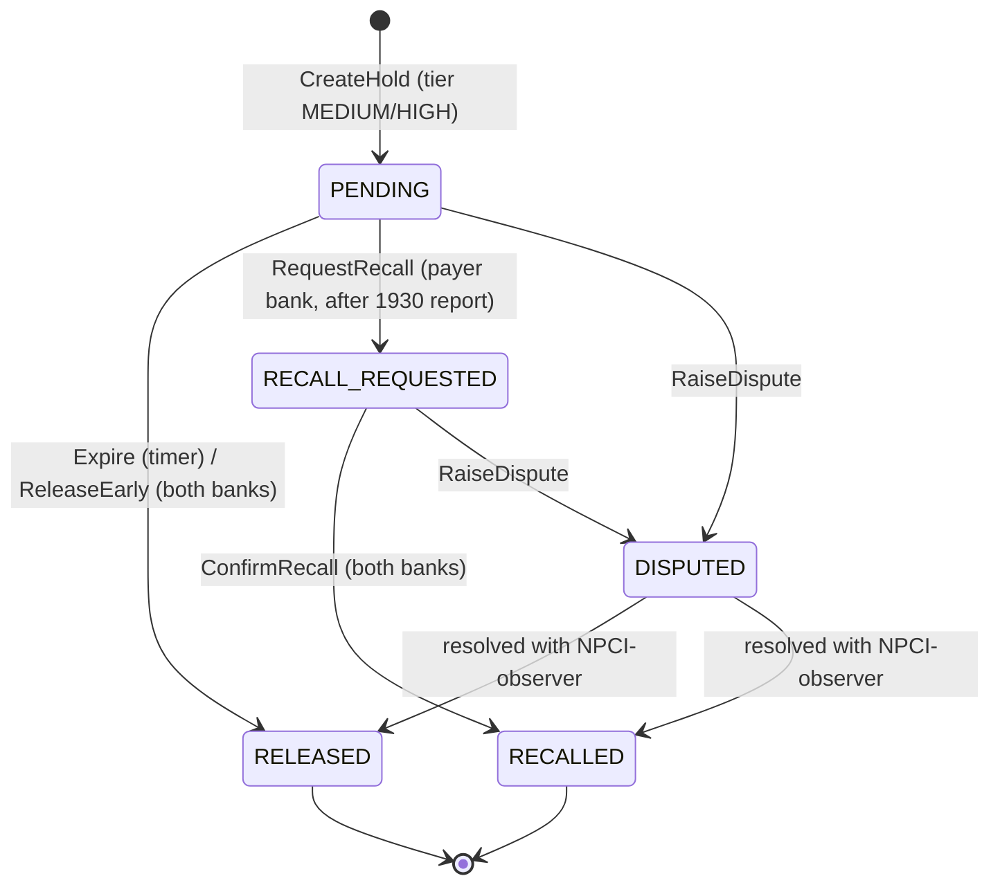
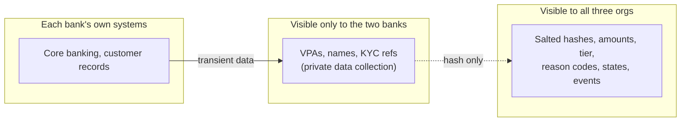

# TwoKey — Architecture

> **Status:** This document describes the designed architecture of the TwoKey prototype. Components are being implemented during the hackathon coding phase; see the [README roadmap](../README.md#roadmap). Everything labelled "mock" is a simulation and is never presented as a live NPCI, bank or Citi integration.

## 1. Design principle

Python services make every decision; Drunix holds only the shared state that two banks must agree on.

A held UPI credit is effectively co-owned by two independent, regulated institutions with opposing incentives. The payer's bank wants funds returned to a victim; the payee's bank must protect its customer from wrongful reversal. TwoKey puts exactly that object — the `ConditionalCredit` — on a permissioned ledger where both banks must endorse every change.

## 2. High-level architecture



## 3. Components and responsibilities

| Component | Responsibility | Built or mocked |
| --- | --- | --- |
| Payer app | Initiates a P2P payment | Mock |
| Mock UPI switch | Accepts payments, enforces NPCI OC-215 response timers and status-check limits, routes LOW to instant credit and MEDIUM/HIGH to `CreateHold` | Mock (built) |
| Risk-tier service | Computes features, returns tier, hold length and reason codes | Built |
| Bank ops | Recall requests from 1930 reports, keeper for expiries, reconciliation across switch, ledger and core banking | Built |
| Mock core banking | Simulated credits and refunds for both banks | Mock |
| Mock 1930 helpline | Simulated victim complaints | Mock |
| Fabric Gateway | REST bridge between Python services and Drunix | Built |
| Drunix peers | PayerBank and PayeeBank endorse; NPCI-observer reads and co-signs disputes | Built (local network) |
| `ConditionalCredit` chaincode | State machine, endorsement rules, private data | Built |
| Read model and dashboard | PostgreSQL view of credits and metrics | Built |
| Policy simulator | Synthetic population and policy comparison | Built |

## 4. The ConditionalCredit state machine



LOW-tier transfers never enter the ledger; they credit instantly through the switch.

### On-chain object (shared channel)

```go
type ConditionalCredit struct {
    TxnRef      string   // UPI RRN; idempotency key
    AmountPaise int64
    PayerBankID string
    PayeeBankID string
    HashedPayer string   // salted hash of payer VPA
    HashedPayee string   // salted hash of payee VPA
    Tier        string   // MEDIUM | HIGH
    ReasonCodes []string // e.g. NEW_ACCT, HIGH_FAN_IN
    HoldUntil   int64    // unix seconds
    State       string   // PENDING | RELEASED | RECALL_REQUESTED | RECALLED | DISPUTED
    Events      []Event  // who, what, when
}
```

### Endorsement policies

| Operation | Policy |
| --- | --- |
| `CreateHold`, `ConfirmRecall`, `ReleaseEarly`, `Expire` | `AND('PayerBankMSP.peer','PayeeBankMSP.peer')` |
| `RequestRecall` | PayerBank |
| `RaiseDispute` | `AND(raiser, 'NPCIObserverMSP.peer')` |
| `GetCredit`, `History` | Query only |

Open design question: whether a recall should finalise automatically if the payee bank does not respond within a time limit. For the prototype it waits for both banks.

## 5. Drunix capabilities used

| Drunix element | How TwoKey uses it |
| --- | --- |
| Multi-organisation network design | Three orgs; joint control enforced cryptographically, not by procedure |
| Chaincode (Go) | `ConditionalCredit` state machine and its contracts |
| Transient store / private data | VPAs, names and KYC references passed via transient data into a collection shared only by the two banks |
| SQL state database | Regulator and NPCI-observer queries over held credits (e.g. HIGH-tier holds per bank, recalls by reason code); feeds reconciliation |
| Fabric Gateway SDK | TypeScript bridge from Python services; chaincode events stream to the read model |

Drunix is NPCI's open-source enterprise fork of Hyperledger Fabric, backward-compatible with Fabric 2.5.x. If Drunix setup stalls, the same design runs on Fabric 2.5.

## 6. Data flow

**Normal path (held credit, no fraud)**

1. Payer app sends a P2P payment to the mock switch.
2. Switch calls `POST /risk/score`; risk service returns `MEDIUM`/`HIGH`, hold length and reason codes.
3. Switch submits `CreateHold` through the gateway; both bank peers endorse; state = PENDING.
4. Chaincode event updates the read model; dashboard shows the hold and its expiry.
5. At `HoldUntil`, the keeper submits `Expire`; state = RELEASED; mock core banking credits the payee.

**Fraud path**

1. Victim reports to mock 1930 (`POST /report`).
2. Bank ops (payer bank) submits `RequestRecall`; state = RECALL_REQUESTED.
3. Payee bank submits `ConfirmRecall`, endorsed by both; state = RECALLED.
4. Mock core banking refunds the payer; the full event history is queryable via `History`.

## 7. Trust boundaries and sensitive data



- **Shared channel:** salted VPA hashes, amounts, tiers, reason codes, states and events. No personal data.
- **Private data collection:** VPAs, names and KYC references, restricted to the payer and payee banks of each credit.
- **Off-chain:** core banking, customer records and model features stay inside each bank's systems.
- **Authentication and authorisation:** organisation identity comes from Fabric MSP certificates; authorisation is the endorsement policy. The prototype uses the default Fabric CA; production needs HSM-held keys.
- **Correction:** wrong on-chain state is fixed only by compensating transactions; history is never edited.

## 8. Error handling and failure scenarios

| Failure | Handling |
| --- | --- |
| Duplicate `CreateHold` for one TxnRef | Idempotent: second call returns the existing credit |
| Keeper service down at expiry | On restart, scans PENDING credits past `HoldUntil` and submits `Expire` |
| Mock core-banking credit fails after RELEASED | State stays RELEASED; payout job retries with backoff and flags after 3 failures |
| Gateway loses connection mid-submit | Client re-queries by TxnRef before retrying |
| Switch, ledger and core banking disagree | Reconciliation job compares all three periodically and raises exceptions |
| Recall arrives after expiry | Rejected deterministically by state check |
| Colluding single bank attempts release or recall | Endorsement policy rejects the transaction |

## 9. Deployment architecture

**Prototype (planned):** a single machine running Docker Compose — the Drunix test network (three orgs, Raft orderer), the TypeScript gateway, FastAPI services, PostgreSQL and the dashboard.

**Production (would require):**

- One peer set per participating bank and NPCI, hosted in India (RBI payment-data localisation).
- HSM-backed keys and a production certificate authority per organisation.
- Integration with the real UPI switch under NPCI scheme rules, and with bank core banking.
- An RBI direction permitting risk-based lagged credit.

## 10. Scalability and trade-offs

- **Only held credits touch the ledger.** LOW-tier transfers — expected to be the large majority — never reach Drunix, which keeps ledger load proportional to risky volume, not to all UPI volume.
- **Why not a central database:** NPCI could hold credits centrally in the switch. The ledger adds enforced two-party control, non-repudiation and a neutral audit trail for disputes and ombudsmen. This trade-off is stated openly rather than hidden.
- **Raft ordering** tolerates crashes, not malicious orderers; governance therefore rests with known regulated institutions.
- **Throughput claims** are limited to laptop-network measurements; no production performance is claimed.

## 11. Current vs future architecture

| Area | Current prototype design | Future |
| --- | --- | --- |
| Rails | Mock UPI switch, mock core banking, mock 1930 | NPCI UPI switch, bank CBS, NCRP/CFCFRMS integration |
| Risk input | Rules first, LightGBM + SHAP as stretch | Bank mule-detection scores, DPIP-style beneficiary risk |
| Payment types | UPI P2P | IMPS, multi-hop holds |
| Keys | Default Fabric CA | HSM-backed per-org keys |
| Network | Single-machine, 3 orgs | Multi-bank network hosted in India |
